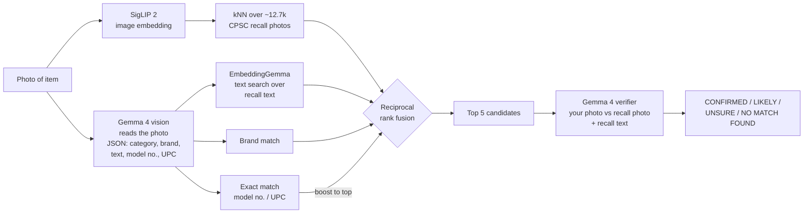

# ClearToList

**Check secondhand children's products against U.S. product recalls before you list them.**

Resellers buy unboxed, unbranded secondhand items with no SKU, so catalog-based recall tools can't help them. And selling a recalled consumer product is illegal no matter how small the seller. ClearToList takes a photo of an item, finds the closest CPSC recalls, and has Gemma 4 vision check the match. You get one of four verdicts:

| Verdict | Meaning |
|---|---|
| 🟥 **CONFIRMED** | A model number or UPC read from the photo matches a recalled product. Don't list it. |
| 🟧 **LIKELY** | Strong visual and text match, but no model number was readable. Photograph the label and scan again. |
| ⬜ **UNSURE** | Weak or conflicting evidence. Shown as a lead to check, never as a match. |
| 🟩 **NO MATCH FOUND** | No match in CPSC recalls. That does **not** mean the item is safe. |

The workflow: **photograph your haul at home, then batch-check it on your own computer before listing.** Everything runs locally on open models, so each scan costs nothing.

It's built for children's products first (cribs, bassinets, sleepers, strollers, high chairs, play yards, toys), the highest-risk category for resellers. The index covers every CPSC consumer-product recall since 2015, except motor vehicles (out of scope). Car seats are regulated by NHTSA, not CPSC, so they're excluded; see [Scope](#scope).

> **Screening aid only, not legal advice.** Results can be wrong in both directions. "No match" means no match in CPSC recalls, not that an item is safe. Always confirm at [cpsc.gov/Recalls](https://www.cpsc.gov/Recalls).

<!-- DEMO_GIF -->

**Online demo:** <!-- RENDER_URL --> a lightweight lookup and a gallery of scans run locally. Full photo scanning runs on your own computer; the demo doesn't run any vision models.

## How it works



1. **Ingest** (`ingest/`): pulls every recall since 2015 from the CPSC Recalls API (`saferproducts.gov`), normalizes model numbers, UPCs and manufacturers, tags a product category, and downloads recall photos. It's incremental (by `LastPublishDate`), retries with backoff when throttled, spaces requests, and falls back to a cached snapshot if the API is down.
2. **Index** (`index/`): SigLIP 2 image vectors over all recall photos, EmbeddingGemma text vectors over title + products + manufacturer + description, and exact-match tables. At this size, a brute-force dot product takes about a millisecond, so there's no vector database.
3. **Read** (`read/`): Gemma 4 through Ollama with a JSON-schema-constrained response.
4. **Retrieve** (`retrieve/`): image kNN and the Gemma read run in parallel. Results are fused with reciprocal rank fusion, and exact model/UPC hits go to the top.
5. **Verify** (`verify/`): Gemma 4 sees your photo next to each candidate's recall photo and text, and answers structured questions (same product type? same brand? model number consistent?). A small, unit-tested function maps the answers to a verdict.
6. **App** (`app/`): local web UI with single scan (verdict banner, side-by-side photos, hazard, remedy, CPSC link, and a "photograph the label" step) and batch check (a folder of photos becomes a CSV of items to pull).

## Quick start

Requires Python 3.12, [uv](https://docs.astral.sh/uv/), [Ollama](https://ollama.com), and an NVIDIA GPU with 6 GB or more (it runs on CPU too, just slowly).

```bash
git clone https://github.com/vinmay/cleartolist && cd cleartolist
./scripts/setup.sh        # deps, models, recall ingest, indexes (first run ~1 h, mostly downloads)
uv run uvicorn app.main:app --port 8000
# open http://localhost:8000
```

Keep it fresh with `./scripts/refresh.sh` (new recalls, then incremental re-index), or let cron run it nightly.

## Evaluation

<!-- EVAL_SUMMARY -->

## Why open models

- **Zero cost per scan.** A reseller may check hundreds of items a week, and there's no per-call API bill.
- **Private.** Photos of your inventory never leave your computer.
- **Tunable.** The whole pipeline is open, so the verifier can be fine-tuned on recall imagery.

## Scope

- **Covered:** CPSC consumer-product recalls since 2015 (furniture, appliances, toys, nursery products, sporting goods and so on).
- **Not covered:** motor vehicles, and **car seats**, which NHTSA regulates. NHTSA's recall API is queried by make, model and year, and its child-seat records carry no product photos, so photo matching isn't possible. When Gemma reads a car seat, the app points to [nhtsa.gov/recalls](https://www.nhtsa.gov/recalls). Also not covered: food, drugs, cosmetics (FDA) and boats (USCG).
- **No healthcare features.**

## Online demo (Render)

`render.yaml` deploys `demo/`, a small FastAPI app with no models. It offers:

- **Lookup** by model number, UPC, brand or product name: exact match, then SQLite FTS5 text search.
- **Gallery** of photo scans run locally with the full pipeline, each with its verdict and evidence.

Its data is a text-only SQLite database (no images, no vectors, about 9 MB). It's rebuilt nightly by GitHub Actions (`.github/workflows/refresh.yml`) and published as the `demo.db` asset on the `data-latest` release. The workflow then calls the Render deploy hook, and on boot the demo downloads the newest database. The demo runs on Render's free tier, so **the first request after about 15 idle minutes can take up to a minute** while the instance wakes up.

## Development

```bash
uv sync
uv run pytest            # normalization, categories, fusion, verdicts, API retry/cache
uvx ruff check .
uv run python -m eval.dataset && uv run python -m eval.run   # full eval (hours on a 6 GB GPU)
```

## Credits and licenses

- **Recall data:** U.S. Consumer Product Safety Commission, via the [CPSC Recalls API](https://www.saferproducts.gov/RestWebServices/Recall). This is U.S. government data. ClearToList isn't affiliated with or endorsed by CPSC. Recall photos are downloaded to each user's own machine and aren't redistributed by this repo; the demo links to them on cpsc.gov.
- **Gemma 4** (E2B / E4B): Apache 2.0, [license](https://ai.google.dev/gemma/docs/gemma_4_license).
- **EmbeddingGemma 300M**: [Gemma Terms of Use](https://ai.google.dev/gemma/terms).
- **SigLIP 2** (`google/siglip2-base-patch16-224`): Apache 2.0.
- **Eval negatives:** Wikimedia Commons photos under CC0, public domain, CC BY or CC BY-SA. Author, license and source page for each are in [`eval/negatives_manifest.json`](eval/negatives_manifest.json).
- No third-party code was copied into this repo; dependencies are listed in `pyproject.toml`.

Code: Apache 2.0 (see `LICENSE`).
