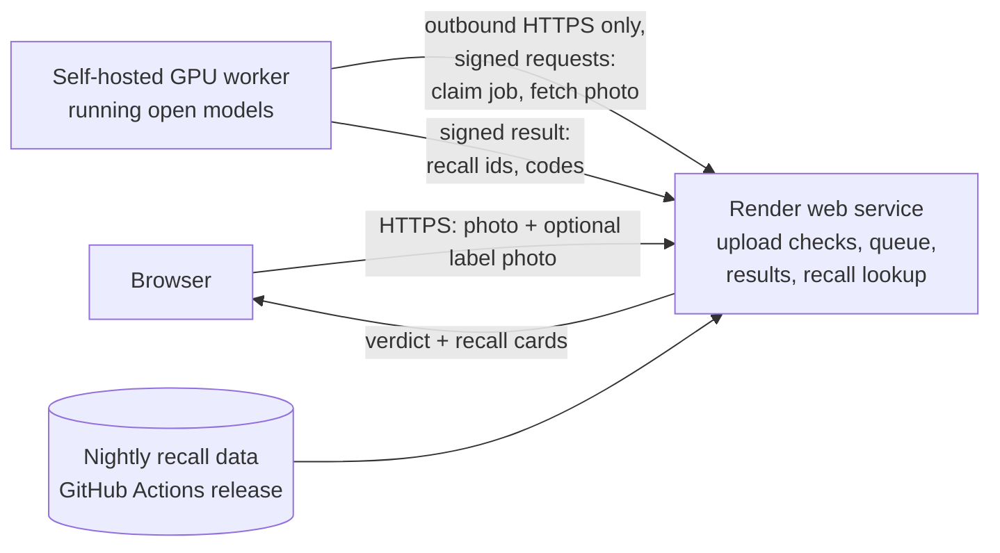
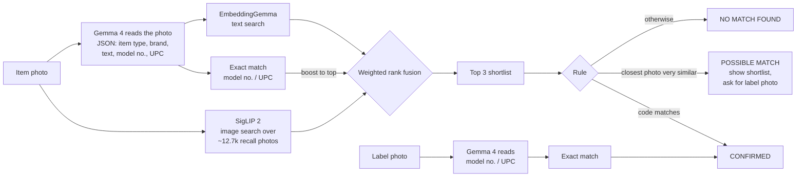
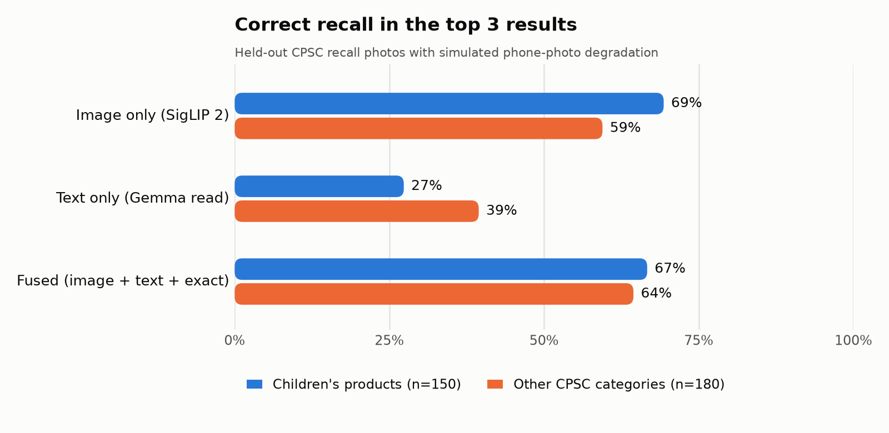

#  ClearToList

**Check secondhand products against U.S. product recalls before you list them, children's products first.**

Resellers buy unboxed, unbranded secondhand items with no SKU, so catalog-based recall tools can't help them. And selling a recalled consumer product is illegal no matter how small the seller. ClearToList works in two photos: a photo of the item finds the closest CPSC recalls, and a photo of its label settles it by model number or UPC. You get one of three verdicts:

| Verdict | Meaning |
|---|---|
| 🟥 **CONFIRMED** | A model number or UPC read off the item matches a recalled product. Don't list it. |
| 🟧 **POSSIBLE MATCH** | The item looks similar to the recalls shown side by side with your photo. That alone doesn't mean it's recalled: photograph the label and scan it. |
| ⬜ **NO MATCH FOUND** | No match in CPSC recalls. That does **not** mean the item is safe. |

Only CONFIRMED is an alarm. Looking similar never is: in testing, too many ordinary products look like recalled ones.

The workflow: **photograph your haul at home, then check each item before you list it**, either on the hosted site or with the whole scanner on your own computer. Both run the same open models.

It covers every in-scope CPSC consumer-product recall since 2015, and it's tuned and measured for children's products first (cribs, bassinets, sleepers, strollers, high chairs, play yards, toys), the highest-risk category for resellers. Other categories (heaters, chargers, furniture, kitchen goods, tools, sports gear, apparel and so on) are checked the same way and measured separately. Motor vehicles are out of scope, and car seats are regulated by NHTSA, not CPSC, so they're excluded; see [Scope](#scope).

> **Screening aid only, not legal advice.** Results can be wrong in both directions. "No match" means no match in CPSC recalls, not that an item is safe. Always confirm at [cpsc.gov/Recalls](https://www.cpsc.gov/Recalls).

<!-- DEMO_GIF -->

**Try it: [cleartolist.onrender.com](https://cleartolist.onrender.com)**. Try a sample photo, or scan your own: there are free photo scans for everyone each day, and an invite code skips the daily limit. The recall lookup by model number, UPC, brand or name is always open.

| The scanner on a phone | Label matches a recall: CONFIRMED | Looks similar: POSSIBLE MATCH |
|---|---|---|
|  |  |  |

<sub>Screenshots show CPSC recall photos (U.S. government works) and simulated scans built from them. The play yard photo in the POSSIBLE MATCH example: "A crib, bassinet and changing table…" by [Famartin](https://commons.wikimedia.org/wiki/File:2022-11-20_23_49_56_A_crib,_bassinet_and_changing_table_in_the_Mountainview_section_of_Ewing_Township,_Mercer_County,_New_Jersey.jpg), [CC BY-SA 4.0](https://creativecommons.org/licenses/by-sa/4.0); that screenshot is shared under the same license. Only the recall's inclined-sleeper accessory was recalled, and only its label could say whether this play yard came with one.</sub>

## How it works

### The service



- **Render web service** (`demo/server.py`): serves the page, checks every upload, keeps a small in-memory job queue, re-checks the worker's results against its own copy of the recall data, and renders the recall cards. It runs no models.
- **GPU worker** (`worker/worker.py`): a self-hosted GPU worker running open models. It polls Render for jobs over outbound HTTPS, runs the pipeline below, and posts back recall ids, matched codes and a few fixed note codes. It has no inbound ports.
- **Recall data:** a text-only SQLite database rebuilt nightly by GitHub Actions and published as a release asset; Render downloads it on boot.

### The scan



1. **Ingest** (`ingest/`): pulls every recall since 2015 from the CPSC Recalls API (`saferproducts.gov`), normalizes model numbers, UPCs and manufacturers, tags a product category, and downloads recall photos. It's incremental (by `LastPublishDate`), retries with backoff when throttled, spaces requests, and falls back to a cached snapshot if the API is down.
2. **Index** (`index/`): SigLIP 2 image vectors over all recall photos, EmbeddingGemma text vectors over recall text, and exact-match tables. At this size a brute-force dot product takes about a millisecond, so there's no vector database.
3. **Read** (`read/`): Gemma 4 E4B through Ollama, with the response constrained to a JSON schema.
4. **Retrieve** (`retrieve/`): image search and the Gemma read run in parallel, fused with weighted reciprocal rank fusion; exact model/UPC hits go to the top.
5. **Decide** (`verify/verdict.py`): a small, unit-tested rule. Only a model number or UPC that matches a recall gives CONFIRMED, unless a brand read off the item contradicts that recall. If the closest shortlisted recall photo is very similar (SigLIP 2 cosine ≥ 0.81, chosen on the dev split), the shortlist is shown as POSSIBLE MATCH with a request for a label photo. Otherwise NO MATCH FOUND. No model ever states the verdict.
6. **Label step** (`verify/pipeline.py`): the label photo is read for a model number or UPC; a match confirms, and anything else keeps the item's verdict with a note on what the label showed.

## Security and privacy

- **Uploads:** one item (plus an optional label photo), or a batch of up to 10 item photos with one combined report. JPEG, PNG or WebP only, identified by their bytes, not the filename; 8 MB and about 30 megapixels max (decompression bombs are refused). Every photo is decoded and re-encoded, which drops all metadata, including GPS location, and anything appended to the file.
- **Retention:** photos are held in memory and deleted as soon as their scan finishes; if the scanner is busy, they're deleted after eight minutes at most. Text results are kept for ten minutes so the page can show them. Only anonymous counts are kept; no photos, filenames or client addresses are logged.
- **Abuse limits:** a public daily allowance of free photo scans (`CTL_PUBLIC_DAILY_SCANS`, default 50 photos a day across all visitors) and invite codes that skip it; three sample photos that run real scans without a code; per-client rate limits on photos, lookups, polling, invite requests and usage events; a queue capped at 20 photos in total and 10 per client, which turns new jobs away when full; and job timeouts. A batch counts once per photo against every one of these limits, and samples count against the queue and rate limits too. A kill switch turns photo uploads off: an environment flag, plus a signed admin request (`scripts/killswitch.py`) that takes effect instantly without a redeploy.
- **Worker isolation:** the worker only makes outbound HTTPS requests to the service. Every request is HMAC-signed (timestamp, nonce and body hash, compared in constant time, replays refused). It downloads photo bytes only from the service's own job endpoint, never a URL from job data, and executes nothing derived from a job.
- **Untrusted model output:** text Gemma reads off a label could try to inject instructions. Reads are schema-constrained JSON, verdicts come only from the rule, the worker sends back only ids, codes and fixed note codes, and the service re-checks any claimed code against its own data before showing CONFIRMED. Everything shown is escaped.
- **Web:** HTTPS only (HSTS), a strict Content Security Policy with no inline scripts, no framing, `nosniff`, same-origin requests only, and generic error messages with no stack traces.
- **Invite requests** store only an email address, the time and, if asked for, recall-alert categories, after an explicit consent tick; a honeypot field and a rate limit keep bots out. They live in a Render Postgres that accepts no outside connections; the owner exports them through a signed admin endpoint.
- **Usage counts, not tracking:** daily totals of named events (visits, a `?ref=` channel tag from an allowlist, scans, verdicts by tier, lookups, invite requests, a few clicks and a "Was this helpful?" yes/no). No cookies, IP addresses, user agents, referrer headers or per-person data. A private stats page shows them behind the admin secret.
- **Secrets** live only in environment variables and Render's secret settings (see `.env.example`); CI scans the whole git history for leaked secrets with gitleaks.

## Run it

### Hosted service

1. Deploy `render.yaml` as a Render Blueprint (it also creates the free Postgres for invite requests and usage counts, and passes its connection string as `DATABASE_URL`). Set `CTL_INVITE_CODES`, `CTL_WORKER_SECRET` and `CTL_ADMIN_SECRET` in the Render dashboard, optionally `CTL_PUBLIC_DAILY_SCANS`, then set `CTL_UPLOADS_ENABLED=1` when you're ready.
2. On a machine with an NVIDIA GPU (6 GB is enough), do the local setup below, then start the worker with the same secret:

```bash
scripts/run_worker.sh /path/to/worker.env   # a private file with CTL_SERVER_URL and CTL_WORKER_SECRET
```

Render's free tier sleeps after about 15 idle minutes, and **the first request after that can take up to a minute** while it wakes; the page says so while it waits. When no worker is connected, the page shows that scanning is temporarily unavailable and the lookup keeps working.

### Everything on your own computer

Requires Python 3.12, [uv](https://docs.astral.sh/uv/), [Ollama](https://ollama.com), and an NVIDIA GPU with 6 GB or more (it runs on CPU too, just slowly).

```bash
git clone https://github.com/vinmay/cleartolist && cd cleartolist
./scripts/setup.sh        # deps, models, recall ingest, indexes (first run ~1 h, mostly downloads)
uv run uvicorn app.main:app --port 8000
```

The local app (`app/`) has the same two-photo flow plus a batch mode that turns a folder of photos into a CSV of items to pull or check. Keep the data fresh with `./scripts/refresh.sh`.

## Evaluation

All numbers are from a held-out test on a 6 GB consumer GPU. Each positive is a CPSC recall photo with simulated phone-photo degradation; that photo and every copy or near-duplicate of it (SigLIP 2 cosine ≥ 0.95) are removed from the index for that query, so a query can only match through *other* photos of the same recall. Negatives are licensed, same-category, non-recall product photos from Wikimedia Commons ([manifest](eval/negatives_manifest.json)). Rules were tuned on a separate dev split that shares no recall and no photo with the test set. Full tables: [Run 3](eval/results.md), [gate and verifier choice on dev](eval/gate.md).



**Run 3** (rules frozen on dev before the test was run once; the CONFIRMED rows also show one post-test fix, below):

| | Children's products (headline) | Other CPSC categories | Label close-ups (children's) |
|---|---|---|---|
| positives / negatives | 150 / 41 | 180 / 83 | 40 / 0 |
| **right recall shown to the user** (CONFIRMED, or in a POSSIBLE MATCH shortlist) | **34%** | **37%** | **15%** |
| right recall shown, Run 3b (adds grey "closest recalls to check" for children's products) | 63% | 38% | 57% |
| lookalikes shown any recall: Run 3 → Run 3b | 5% → 98% | 24% → 37% | n/a |
| right recall in the top-3 shortlist, before the POSSIBLE MATCH gate | 67% | 64% | 60% |
| image only, top-3 | 69% | 59% | 18% |
| CONFIRMED: count, right (Run 3 → with brand check) | 0 → 0 | 4, 2 right → 3, 2 right | 2, 2 right → 2, 2 right |
| false alarms on negatives (CONFIRMED) (Run 3 → with brand check) | 0% → 0% | 1 of 83 → 0 | n/a |
| POSSIBLE MATCH on negatives | 5% | 24% | n/a |
| median scan time | 6.5 s | 7.2 s | 7.1 s |

What this says, plainly:

- **From the item photo alone, a user sees the right recall about a third of the time** (34% children's, 37% other categories). The right recall is in the top-3 shortlist more often (67% and 64%), but a shortlist is only shown when the closest recall photo is very similar, so most of those never reach the user. That gate is deliberate: on dev, showing every shortlist prompted on almost every ordinary product.
- **The label photo is what makes a verdict reliable.** CONFIRMED needs a model number or UPC read off the item that matches a recall; with the brand check it's right 4 of 5 times across all three test sets and raises no false alarm on 124 lookalikes. Generic-looking products (cribs and sleepers: 45% image top-3; furniture: 40%) depend on that label, and on label close-ups Gemma's reading finds the recall where image search can't (60% vs 18% top-3).
- **The kill criterion** set before building the app was about 60% top-3 on children's products, from the photo alone; the spike passed at 71% (n=90) and the test lands at 67-69%. It measures whether retrieval is worth building on, not what a user sees, which is the 34% above.
- **What's weak:** a standalone label photo rarely clears the image-similarity gate (15% shown right), which is why the two-photo flow reads the label for codes instead of treating it as an item photo.
- **Other categories prompt more often.** For non-children's products, the item photo finds the right recall about as well (64% top-3, 37% shown), but ordinary lookalikes get a POSSIBLE MATCH prompt 24% of the time, against 5% for children's products. It's worst for sports and recreation (42%), kitchen (36%) and tools and outdoor (33%), where many recalled products look like everyday ones. The single similarity threshold was chosen on all dev categories together; per-category thresholds, chosen on dev, are the next planned fix. The prompt is never an alarm: CONFIRMED raised no false alarm on 83 other-category lookalikes after the brand check.

**Post-test display policy, disclosed: Run 3b** ([details](eval/display_policy.md)). When nothing triggers for a children's product, the page now shows its three closest recalls in grey as "closest recalls to check", worded as suggestions, not matches, with no alarm; the verdict stays NO MATCH FOUND. The rule (adopt only if right recall shown rises at least 15 points on dev) was fixed first; on dev it rose 25% → 59% for children's products, so it was adopted and applied once to the saved Run 3 rows: 34% → 63%. The cost is plain in the table: nearly every children's lookalike (98%) now gets three suggestions too, which is why they're grey and never called a match. Alarms are unchanged: CONFIRMED still needs a code.

**Post-test fix, disclosed** ([details](eval/confirm_fix.md)). Run 3 had 2 wrong CONFIRMED verdicts out of 4 in the other-categories run. One was a false alarm: a camera-battery label listing compatible cameras ("EOS 100D") matched an unrelated recall's model number "100D". The other had the right model number (Intertex VP-33), but that number appears in two recalls of the same product line and the other one was picked. On the dev split, a rule that vetoes a code match when the brand read off the item contradicts the recall removed both wrong CONFIRMED verdicts there and kept all correct ones. Applied once to the saved Run 3 rows (verdict step only), it removes the battery false alarm (4 → 3 CONFIRMED, 2 right, false alarms on negatives 1 → 0). The shared-model-number case stays wrong and is disclosed; no rule for it could be validated on dev.

Limits: positives are official product photos degraded to look like phone shots, not real thrift-store photos; Commons negatives aren't verified non-recalled (two were removed after an audit, see the manifest); play yards (1 positive) and high chairs (13) are too small to read anything into.

**A random sample of test scans, misses included.** Simulated phone photos of held-out CPSC recall photos (hidden from the index for each scan), drawn at random from the test set. "Photos scanned" says whether a label photo was added. The result counts only CONFIRMED and POSSIBLE MATCH; it doesn't count the grey closest-recall suggestions.

| Photos actually from | Photos scanned | Verdict | Result |
|---|---|---|---|
| [Target Toddler Boots](https://www.cpsc.gov/Recalls/2019/Target-Recalls-Toddler-Boots-Due-to-Choking-Hazard) | item + label | NO MATCH FOUND | missed (no match shown) |
| [Huffy Corporation Ride-On Toys](https://www.cpsc.gov/Recalls/2022/Huffy-Corporation-Recalls-Ride-On-Toys-Due-to-Fall-and-Injury-Hazards) | item + label | POSSIBLE MATCH | right recall among the closest shown |
| [SHEIN Distribution Corporation Michley Children's Pajamas](https://www.cpsc.gov/Recalls/2026/SHEIN-Distribution-Corporation-Recalls-Michley-Childrens-Pajamas-Due-to-Risk-of-Serious-Injury-or-Death-from-Burn-Hazard-Violate-Mandatory-Standard-for-Childrens-Sleepwear) | item + label | POSSIBLE MATCH | right recall among the closest shown |
| [One Stop Shop Children's Pajamas](https://www.cpsc.gov/Recalls/2018/One-Stop-Shop-Recalls-Childrens-Pajamas-Due-to-Violation-of-Federal-Flammability-Standard-Sold-Exclusively-at-Foreman-Mills) | item + label | NO MATCH FOUND | missed (no match shown) |
| [Things Remembered Children's Jewelry](https://www.cpsc.gov/Recalls/2016/Things-Remembered-Recalls-Childrens-Jewelry) | item only | NO MATCH FOUND | missed (no match shown) |
| [Blue Star Trading Children's Fishing Toy Games](https://www.cpsc.gov/Recalls/2021/Blue-Star-Trading-Recalls-Childrens-Fishing-Toy-Games-Due-to-Violation-of-Federal-Lead-Content-Ban-Lead-Poisoning-Hazard-Sold-Exclusively-on-Amazon-com-Recall-Alert) | item only | NO MATCH FOUND | missed (no match shown) |
| [UPPAbaby RIDGE Jogging Strollers](https://www.cpsc.gov/Recalls/2022/UPPAbaby-Recalls-RIDGE-Jogging-Strollers-Due-to-Fingertip-Amputation-Hazard-One-Injury-to-Child-Reported) | item only | NO MATCH FOUND | missed (no match shown) |
| [Revelate Designs Bicycle Seat Bags](https://www.cpsc.gov/Recalls/2019/Revelate-Designs-Recalls-Bicycle-Seat-Bags-Due-to-Crash-Injury-Hazards) | item only | NO MATCH FOUND | missed (no match shown) |
| [FXI Novaform ComfortGrande and DreamAway Mattresses](https://www.cpsc.gov/Recalls/2023/FXI-Recalls-Novaform-ComfortGrande-and-DreamAway-Mattresses-Due-to-Risk-of-Mold-Exposure-Sold-Exclusively-at-Costco-Recall-Alert) | item only | POSSIBLE MATCH | right recall among the closest shown |
| [Rheem Water Heaters](https://www.cpsc.gov/Recalls/2016/Rheem-Recalls-to-Repair-Water-Heaters) | item only | NO MATCH FOUND | missed (no match shown) |
| [Fengrong Tool Pressure Washers](https://www.cpsc.gov/Recalls/2026/Fengrong-Tool-Recalls-Pressure-Washers-Due-to-Serious-Risk-of-Injury-or-Death-from-Shock-and-Electrocution-Hazards) | item only | NO MATCH FOUND | missed (no match shown) |

**How we got here, disclosed.** Run 1 ([results](eval/results_run1.md)) used a Gemma verifier and LIKELY/UNSURE verdicts. Error analysis on Run 1's test results found two bugs, fixed in 7bff2ed; Run 2 ([results](eval/results_run2.md)) re-ran the same queries, so its gain over Run 1 is optimistic. The verifier was then taken out of the alarm path entirely, the gate was chosen on the dev split only, and Run 3 ran the test set once with no changes after. On dev, the verifier added one query of top-3 (95 to 96 of 153) for about 23 s more per scan, so it was dropped.

## Who it's for

ClearToList is two-sided:

- **Buyers** check a listing screenshot or a photo before they pay, for free. If it looks like a recalled product, the page gives them a ready-made message asking the seller for a photo of the label.
- **Resellers** check their haul before they list it: batch scans, invite codes that skip the daily limit, and email alerts when new recalls hit the categories they sell.

**Pricing hypothesis (unvalidated, no users yet):** buyer checks stay free; resellers would pay a small monthly fee for batch scanning and recall alerts. Nothing is charged today.

## What's next

- **Per-category POSSIBLE MATCH thresholds**, chosen on the dev split, to cut prompts on other-category lookalikes.
- **More recall sources:** the EU Safety Gate (it publishes product photos) and Health Canada recalls, for resellers outside the U.S.
- **Real thrift-store photos** in the evaluation (the harness is ready: `eval/owner_photos/`).
- **More scanning capacity:** the same worker on rented on-demand GPUs.

## Why open models

- **Cost:** a scan on a self-hosted open model costs only electricity: about 7 s on a consumer GPU drawing roughly 150 W, a few thousandths of a cent. A commercial multimodal API typically charges from a fraction of a cent to a couple of cents per call with two images, and a reseller may check hundreds of items a week. There's no per-call bill to watch.
- **Control:** the models, prompts, thresholds and data are all in this repo, versioned and tested; nothing changes underneath the evaluation.
- **Fine-tunable:** the reader and the shortlist can be trained on recall imagery with standard open tooling.
- **Scale-up path:** the worker is stateless and claims jobs atomically, so more capacity means starting the same worker on rented on-demand GPUs. That isn't built yet.

## Scope

- **Covered:** CPSC consumer-product recalls since 2015 (furniture, appliances, toys, nursery products, sporting goods and so on).
- **Not covered:** motor vehicles, and **car seats**, which NHTSA regulates. NHTSA's recall API is queried by make, model and year, and its child-seat records carry no product photos, so photo matching isn't possible. When Gemma reads a car seat, the app points to [nhtsa.gov/recalls](https://www.nhtsa.gov/recalls). Also not covered: food, drugs, cosmetics (FDA) and boats (USCG).
- **No healthcare features.**

## Development

```bash
uv sync
uv run pytest            # normalization, categories, fusion, verdicts, API retry/cache, hosted service, worker
uvx ruff check .
uv run python -m eval.dataset && uv run python -m eval.run   # full eval (hours on a 6 GB GPU)
```

## Credits and licenses

- **Recall data:** U.S. Consumer Product Safety Commission, via the [CPSC Recalls API](https://www.saferproducts.gov/RestWebServices/Recall). This is U.S. government data. ClearToList isn't affiliated with or endorsed by CPSC. Recall photos aren't redistributed by this repo: the local setup downloads them from CPSC, and the hosted service links to them on cpsc.gov.
- **Gemma 4** (E2B / E4B): Apache 2.0, [license](https://ai.google.dev/gemma/docs/gemma_4_license).
- **EmbeddingGemma 300M**: [Gemma Terms of Use](https://ai.google.dev/gemma/terms).
- **SigLIP 2** (`google/siglip2-base-patch16-224`): Apache 2.0.
- **Archivo** typeface (self-hosted, Latin subset): SIL Open Font License 1.1, see `demo/static/fonts/OFL.txt`.
- **Eval negatives:** Wikimedia Commons photos under CC0, public domain, CC BY or CC BY-SA. Author, license and source page for each are in [`eval/negatives_manifest.json`](eval/negatives_manifest.json).
- No third-party code was copied into this repo; dependencies are listed in `pyproject.toml`.

Code: Apache 2.0 (see `LICENSE`).
